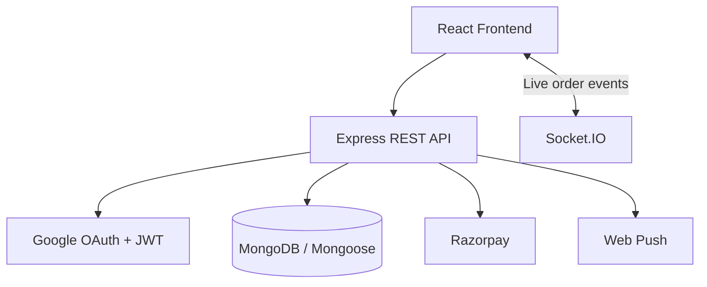

# Campus Food Court — Backend

A Node.js/Express API for campus food ordering, with MongoDB persistence, Google OAuth, role-based dashboards, Razorpay payment integration, push notifications, and Socket.IO updates.

**Frontend:** https://github.com/KISHAN000053/rgipt-food-court-frontend

> **Important:** Sign-in defaults to the RGIPT email domain for backward compatibility. Set `ALLOWED_EMAIL_DOMAINS` for another campus. This is a campus-specific deployment starter, not a zero-configuration multi-tenant product.

## Architecture



## Stack

- Node.js + Express
- MongoDB + Mongoose
- Google OAuth 2.0 via Passport
- JWT authentication in an HTTP-only cookie, with bearer-token fallback
- Socket.IO
- Razorpay
- web-push

## Requirements

- A supported Node.js LTS release and npm
- MongoDB connection string
- Google OAuth credentials and a configured callback URL
- Frontend URL for CORS and OAuth redirects
- Razorpay credentials if online payments are enabled
- VAPID keys if web push notifications are enabled

## Local setup

```bash
npm install
cp .env.example .env
```

Fill in `.env` with local development values before starting the server:

```bash
npm run dev
```

The server defaults to port `5000`. Health check: `GET /api/health`.

For a production-style run:

```bash
npm start
```

Run the automated unit tests with `npm test`. These are focused checks for cart input validation and order-state rules; they do not replace end-to-end testing.

### Seed scripts

These scripts modify the database, so inspect the script and confirm `MONGODB_URI` points to the intended database before running them.

- `npm run seed:hostels` — adds the example RGIPT hostel records. Edit `scripts/seedHostels.js` for your campus first.
- `npm run seed:shop5-addons` — legacy, campus-specific add-on migration for a shop matching “witcher burrito”. Do **not** run it on another campus unless you have deliberately adapted it.

There is no general-purpose shop/menu seed script in this repository.

## Environment variables

| Variable | Purpose |
|---|---|
| `PORT` | HTTP server port; defaults to `5000` |
| `MONGODB_URI` | MongoDB connection string |
| `JWT_SECRET` | Strong, unique secret used to sign session tokens |
| `GOOGLE_CLIENT_ID` | Google OAuth client ID |
| `GOOGLE_CLIENT_SECRET` | Google OAuth client secret |
| `GOOGLE_CALLBACK_URL` | Exact OAuth callback URL registered with Google |
| `FRONTEND_URL` | Frontend origin used for CORS and redirects |
| `ALLOWED_EMAIL_DOMAINS` | Comma-separated allowed domains, without `@`; defaults to `rgipt.ac.in` |
| `ADMIN_EMAILS` | Comma-separated admin email addresses |
| `NODE_ENV` | Set to `production` for production cookie behavior |

Payment and push-notification routes may require additional provider-specific variables. Inspect the relevant route/service files and configure those values in your hosting provider's secret manager; never put real secrets in README files or commit them to Git.

## Detailed guides

- [API reference](docs/API.md) — endpoint map, access levels, payment flow, and Socket.IO events.
- [Operations and deployment](docs/OPERATIONS.md) — environment setup, Render deployment, campus reuse, and security operations.

## API overview

| Method | Route | Purpose |
|---|---|---|
| GET | `/api/health` | Health check |
| GET | `/api/auth/google` | Start Google sign-in |
| GET | `/api/auth/me` | Current authenticated user |
| POST | `/api/auth/logout` | Clear the auth cookie |
| PATCH | `/api/users/profile` | Update profile details |
| GET | `/api/shops` | List shops |
| GET | `/api/shops/:id/menu` | Get a shop menu |
| GET | `/api/menu/search?q=` | Search menu items |
| POST | `/api/orders` | Place an order |
| GET | `/api/orders/my` | Get the current user's orders |
| GET | `/api/owner/orders` | Shop-owner order view |
| PATCH | `/api/owner/orders/:id/status` | Update order status |

Additional admin, payment, hostel, settings, push, and owner endpoints are mounted in `server.js`; review their route files for the full contract.

## Deployment (Render or similar Node host)

1. Create a Node.js web service connected to this repository.
2. Build/install command: `npm install`.
3. Start command: `npm start`.
4. Set all environment variables in the host dashboard.
5. Configure the Google OAuth callback URL exactly as deployed.
6. Set `FRONTEND_URL` to the deployed frontend origin.
7. Set `ALLOWED_EMAIL_DOMAINS` to the campus domain(s) you actually permit.
8. Confirm MongoDB network access permits the host and is not unnecessarily open to everyone.
9. Verify the health endpoint, Google sign-in, order flow, payment verification/webhooks, and Socket.IO behavior before accepting real orders.

## Reuse for another campus

Before using this for another institution:
1. Set `ALLOWED_EMAIL_DOMAINS` to the intended campus domain(s), separated by commas.
2. Review campus names, hostel/room assumptions, seed data, and campus-specific scripts.
3. Configure the OAuth consent screen, callback URL, frontend origin, and administrator accounts.
4. Review role checks, ownership checks, request validation, rate limits, and payment-webhook verification.
5. Test student, shop-owner, and admin permissions with separate accounts.
6. If hosting multiple colleges from one deployment, design and enforce tenant isolation in the database and every relevant query first. Merely changing branding or allowing several email domains does not create safe multi-tenancy.

## Security checklist

- Never use a fallback JWT secret such as `secret`; set a strong unique `JWT_SECRET` in every environment.
- Never deploy with placeholder OAuth credentials or commit real credentials.
- Rotate credentials that have been exposed. Removing a value from the latest file does not remove it from Git history.
- Keep `.env` files out of Git; store production secrets in the host's environment settings.
- Restrict CORS to trusted origins and verify authorization on every protected backend route.
- Validate webhook signatures and never trust payment success reported by the client.
- Back up the database before migrations or seed operations.

## License and commercial use

This repository includes an MIT license, permitting commercial use, modification, and redistribution subject to its terms. Third-party libraries, payment providers, Google OAuth, and images/fonts/assets have their own terms. The license does not certify production readiness or compliance with a campus's policies.
